# Sensor assembly procedures
This document details the procedures used to build a Wet Bulb Globe Temperature Sensor Assembly. 

# Stage 1 - Preparing the PCB

Create two 8-pin female headers and one 2-pin header for connecting the microcontroller to the PCB

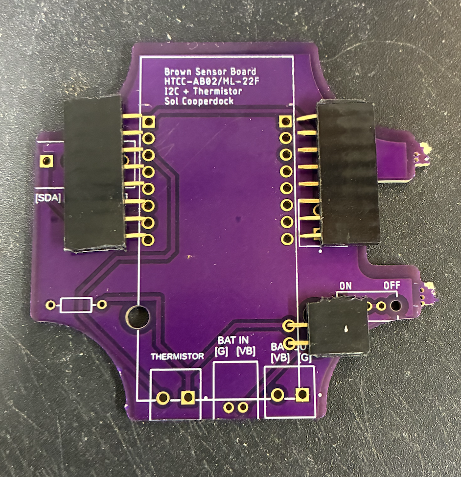

Insert the headers into the corresponding holes as shown and flip over the board for soldering.

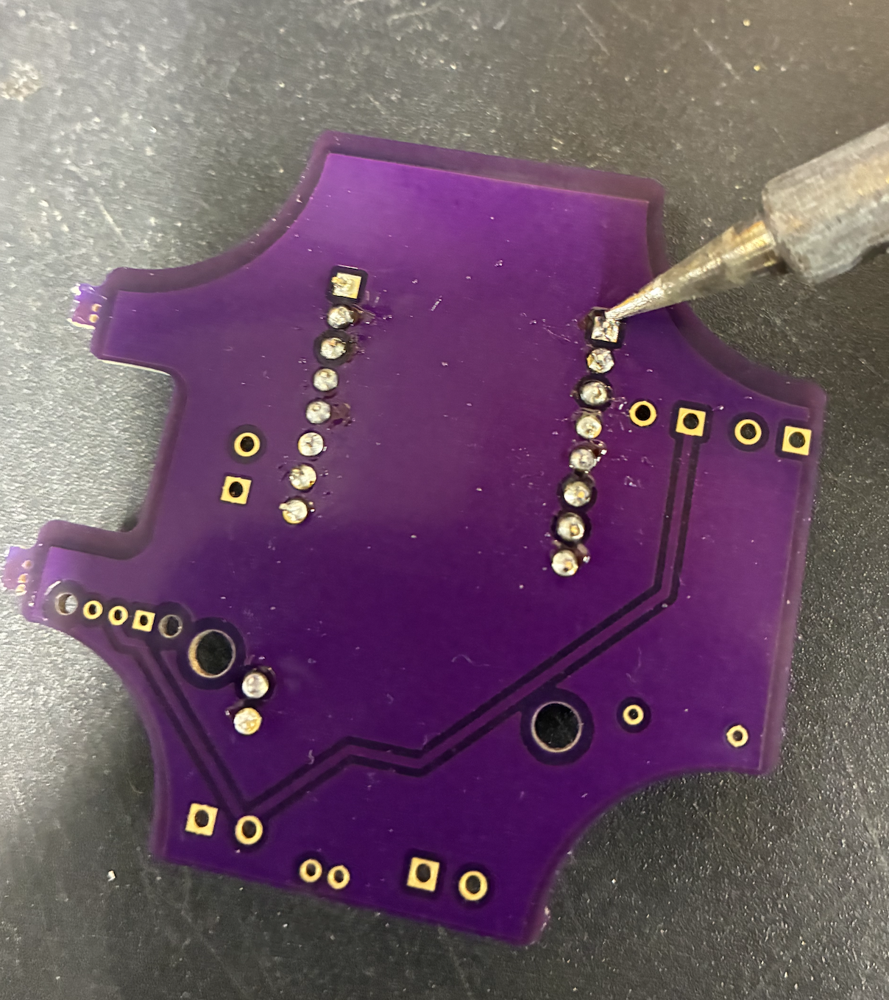

Insert a 2-pin JST connector in the "BAT IN" location for a battery and a switch into the switch position and solder.

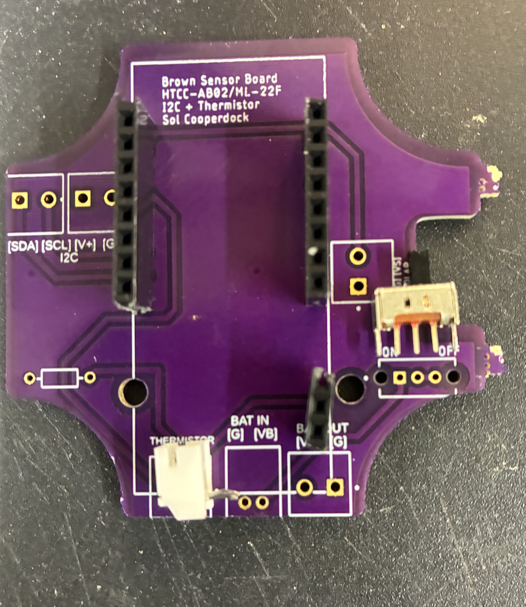

Flip over the board and solder (you may need to tape these components to the board).

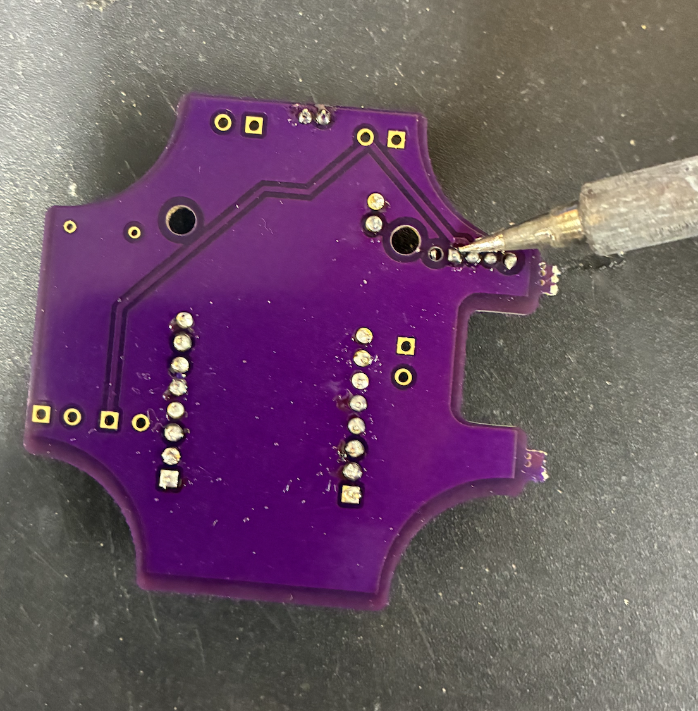

Locate five 2-pin terminals for the "thermistor", "BAT OUT, and I2C Connections.

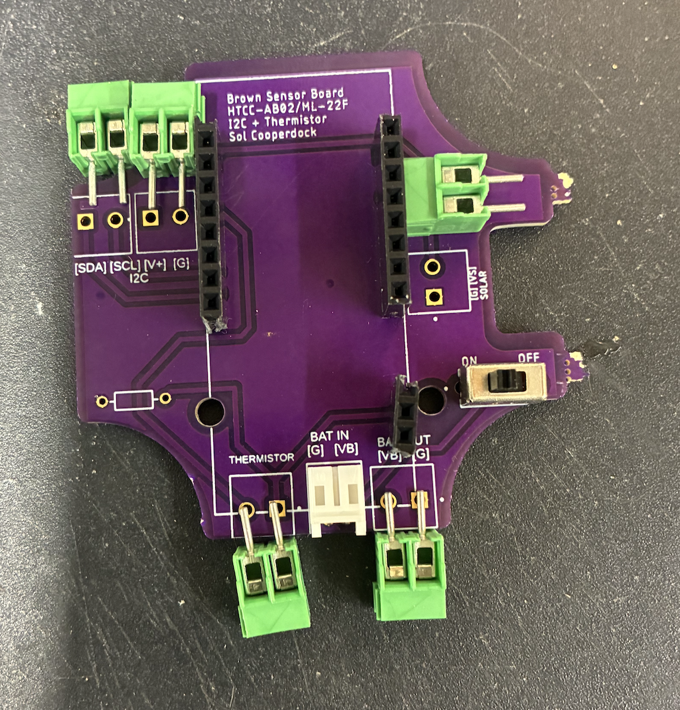

Insert each terminal into all the labelled locations shown, with the openings facing the text on the PCB, flip over and solder.

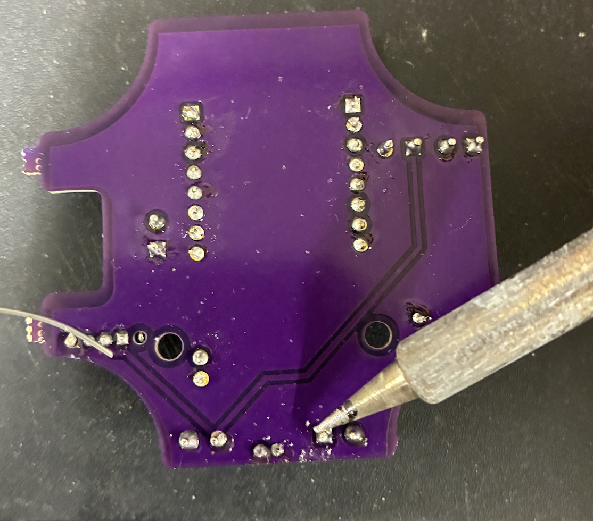

Find a 10K-ohm resistor to solder into the remaining non-labelled position as shown and solder after trimming excess leads

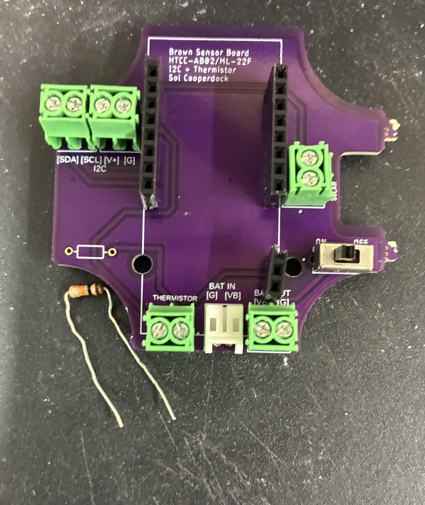

# Stage 2 - prepare the MCU

Create two 8-pin male headers and one 2-pin male header for soldering onto the MCU

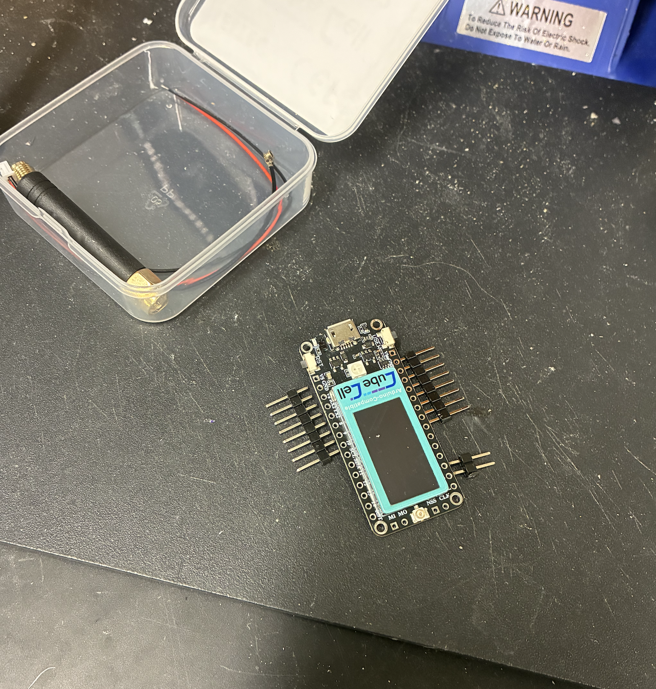

Insert the 8-pin male headers into the bottom 8 positions of the MCU on each side ("Vin" through "GPIO7" and "VS" through "GPIO10") and Insert the 2-pin header into the "~3" and "~2" As Shown below. 
Confirm the correct positions by referring to the image below.

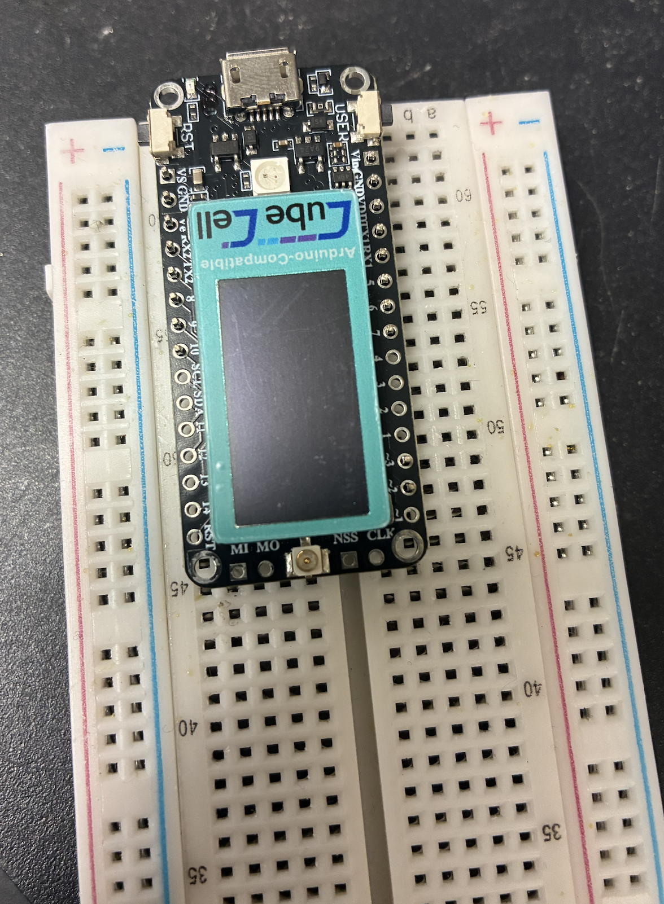

Then, insert the pins into a breadboard for ease of soldering. Ensure the pins are flush with the MCU and solder all.

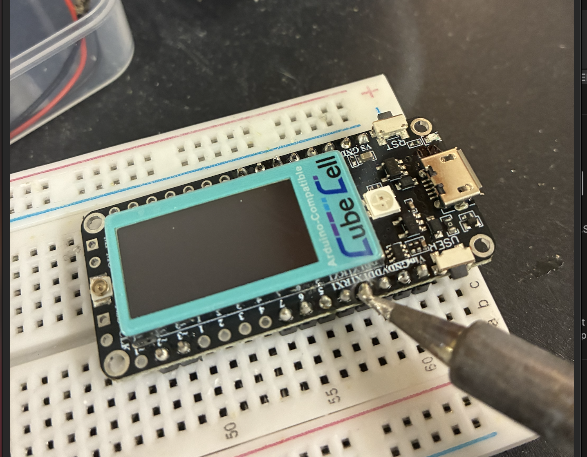

Insert the MCU into the PCB board and ensure the correct pins are connected.

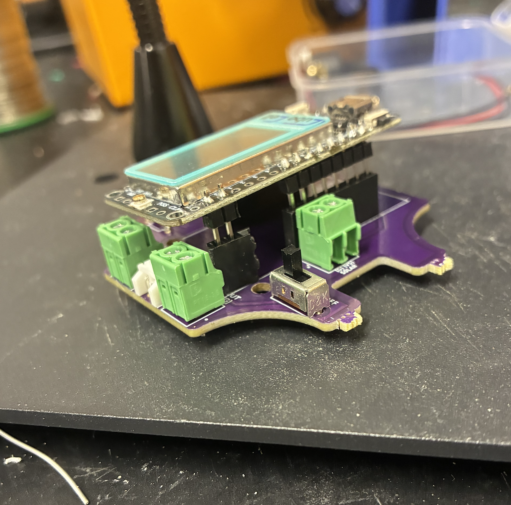

# Stage 3 - battery assembly
With the PCB switch to the "off" position, remove the MCU and attach a 400 mAh battery to the "BAT IN" port.

Insert a 2-pin JST connector into the MCU and add a 2 character board label for MCU identification.

Insert the other end of the JST connector into the "BAT OUT" port. Ensure the RED wire goes into "VB" and the BLACK wire goes into "G".

Reinsert the MCU into the PCB, ensure you do not damage the battery. There should be plenty of space between the MCU and the battery if inserted correctly.

To test power, move the switch to the ON position. If no sketch has been uploaded to the board, it should flash RGB Testing on the LCD screen, along with different lights, then show the text below. 

Turn off power by moving the switch back to the OFF position.

# Stage 4 - Housing Preparation

There are a total of 11 parts that need to be 3D Printed, as shown above with preferably ASA type UV Resistant Filament
These Include:
    - Bottom Lid Piece with Mounting and Water Drain X 1 
    - Bottom PCB Housing Plate X 1
    - Middle Plates with Hollow Center Cutout X 4
    - Top Plates with Solid Infill X 2 
    - Top Mounting Piece x 1
    - Top Mount with 1/2" NPT Thread & Solar Panel Mount x 1
    - Sensor Module Mounting Piece x 1

All can be printed without supports but a brim is recommended for better print stability. For better quality overall, a printer with an enclosure or a higher heat environment and dehumidification is recommended for printing with ASA Filament
 

Additionally, the following hardware is also needed. These can be found on McMaster-Carr 
    - 6" 8-32 Stainless Steel 18-8 Threaded Rods X 3 (McMaster 95412A821)
    - 8-32 Nylon 6-6 Wingnut X 6 (McMaster 94924A009)
    - 1/2" NPT Standard Male-Female PVC Connector X 2 (McMaster 4880K61)
    - Small #3  Screws X 2 (no more than 1/8" in length)
    - 1/2" NPT Gland 
    - 1/2" PVC Pipe cut to approx. 6" in length or less
    - Hollow Aluminum sphere which can be spray painted black 

Start by 3D Printing the Bottom Lid with Mounting, the top mounting, the solar panel mount, and the Sensor Module Mounting all at 50% Infill Density. 
These can be printed with PLA but ASA is recommended to better resist UV deformation and warping. 

Continue by Printing the Bottom PCB Housing at 50% Infill Density. 
This should be done with ASA 

Print 4 Middle Plates with center cutouts at 50% Infill Density also with ASA.

Finally, Print 2 top plates that don't have a central cutout. 
These must be printed with ASA at a 100% Infill Desnity 

To prepare the black Globe, drill/cut a 1/2" hole into an aluminum sphere 
Once Drilling is done, spray paint the globe black using any matte black spray paint 

Once the Sphere is dry, it can be bonded to the male end of a 1/2" NPT Connector

Cut a 1/2" PVC Pipe down to no more than 6" in length.
Push the remaining NPT connector Female end and the connector bonded to the globe onto the pipe 

# Stage 5 - Preparing the Sensors and Solar Panel 

The Sensors Needed are the SHT-45 Sensor and a simple thermistor, but a BME280 or any other temperature I2C compatible will work, as shown below.
A solar panel for recharging the battery is also needed 
4-conductor and 2-conductor cables are needed for the assembly

Begin by soldering stripping the 4-conductor cable 
Solder two of the wires/conductors to the "VIN" Positive and "GND" Ground Pins 
Make note of what color wire each pin is connected to 

Solder the remaining set of conductors for the "SCL" and "SDA" Wires for the I2C 
Make note of these colors as well.
Keep a generous amount of excess cable for final assembly

Next, take a 2-conductor cable, strip it, and solder each wire to the thermistor
The colors/poles of these are negligible
Keep a generous amount of excess cable for final assembly

Using another 2-conductor cable, solder the positive and negative pads of the solar panel with generous solder
Keep a generous amount of excess cable for final assembly

# Interlude - set up software

If you have not done so already, this is a good time to set up the TTN connection and flash the software to the MCU. Follow the instructions [here](../Firmware/README.md).

# Stage 6 - Mount the Electronics 
For Final Assembly, use the hardware as metioned before 

Screw in the PCB with MCU using #3 screws in the bottom PCB Holding plate and secure

Remove support material on the bottom Lid mount and thread a 1/4" NPT Cable gland through the corresponding hole as shown
The plastic nut for the gland should be in the recessed area on the inside of the plate as shown

Thread the cables for the I2C temperature sensor, thermistor, and solar panel through the gland
Ensure that the cables are threaded through as shown 

Connect the Positive and negative wires from the sensor's "VIN" and "GND" pins respectively into the "V+" And "G" labelled terminals on the PCB 

Connect the SCL and SDA wires from the sensor's "SCL" and "SDA" pins respectively into the labelled terminals on the PCB 

Connect the positive and negative wires from the solarpanel into the "VS" and "G" Solar terminals respectively 

Connect both wires to the thermistor terminal as shown. Wire colors/polarity does not matter in this case

# Stage 7 - Full Assembly of Housing 

Solder wire leads onto the back of the solar panel

Using a multimeter, test the voltage coming through the wire leads. With lab lighting and the panel pointing generally at the lights, you should read at least 1 v.

Add a generous amount of RTV to the connection to prevent water damage. Seal all electrical connections.

Apply epoxy to the angled part of the solar panel stand and press firmly onto the solar panel as shown below. Let set overnight.

Once epoxy and RTV are set, thread the wire leads through the gland and connect the V+ wire to the Vs terminal and the V- wire to the G terminal.

Test the voltage coming from the solar panel on the solar terminal as well as the Vs and Gnd pins of the MCU. If all connections are correct, the voltage should read at least 1 v as before.

# Stage 8 - close up and mount sensor

Flatten and twist the sensor wires so they will not be in the way of any components when the cover is on. Close the cover, ensuring no wires are in between the housing and cover. Fasten four screws tightly.

Tighten gland around cable to ensure no water infiltration is possible.

Add a label to both sides of the sensor housing.

Locate 2 mount plates and 4 6/32 screws.

With the bubble level holes facing away from the housing, attach the mount plates by threading 2 screws each through the holes in the housing and into the interior threaded holes in the plates. Fasten tightly.

